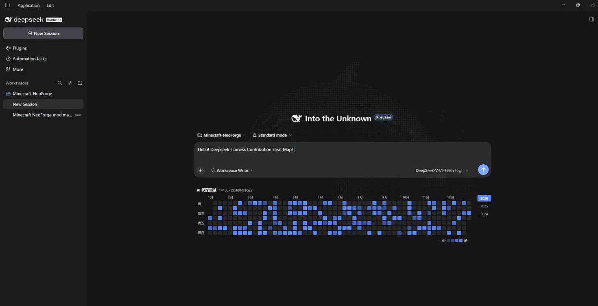
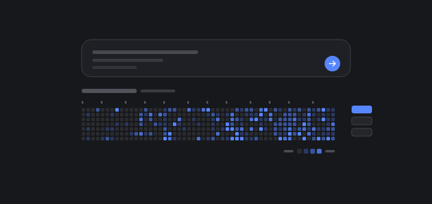

# AI 代码贡献热力图 (DSH Contribution Heatmap)

[](https://badge.fury.io/js/dsh-contribution-heatmap)


这是一个为 [DeepSeek Harness (DSH)](https://github.com/) 打造的原生插件。它会在“新会话”的空白主页（输入框正下方），渲染一个类似 GitHub 的年度代码贡献热力图。一旦你发送消息开始聊天，热力图会自动隐藏。

**纯 ES 模块编写，无需构建步骤，零第三方依赖，不发起任何额外网络请求。**

## 📸 效果预览



<details>
<summary>点击查看极简暗色/亮色模式预览图</summary>

| 暗色模式 | 亮色模式 |
| --- | --- |
|  |  |

</details>

## ✨ 核心亮点

*   **属于 AI 时代的专属维度**：不仅统计代码行数，还精准记录 **Token 消耗量**、**联网搜索次数** 以及 **Git 提交次数**。
*   **沉浸式原生体验**：完美融入 DSH 的暗黑/亮色主题，深邃的蓝色渐变方块（`#5686FE`）极具极客美感。
*   **沉浸式悬浮提示 (Tooltip)**：鼠标悬停即可查看当天的详细数据看板。
*   **极致的响应式**：从超大屏到极限拉伸的窄窗口，热力图会自动缩放，永不布局崩坏。
*   **历史数据留存**：数据持久化在本地 `activity.json` 中，支持按年份切换查看。

## 📦 安装方式

在 DSH 的命令行终端（PowerShell / CMD）中，使用以下命令安装：

```bash
# 将插件安装到 web 配置档案中
dsh plugin --profile web add dsh-contribution-heatmap